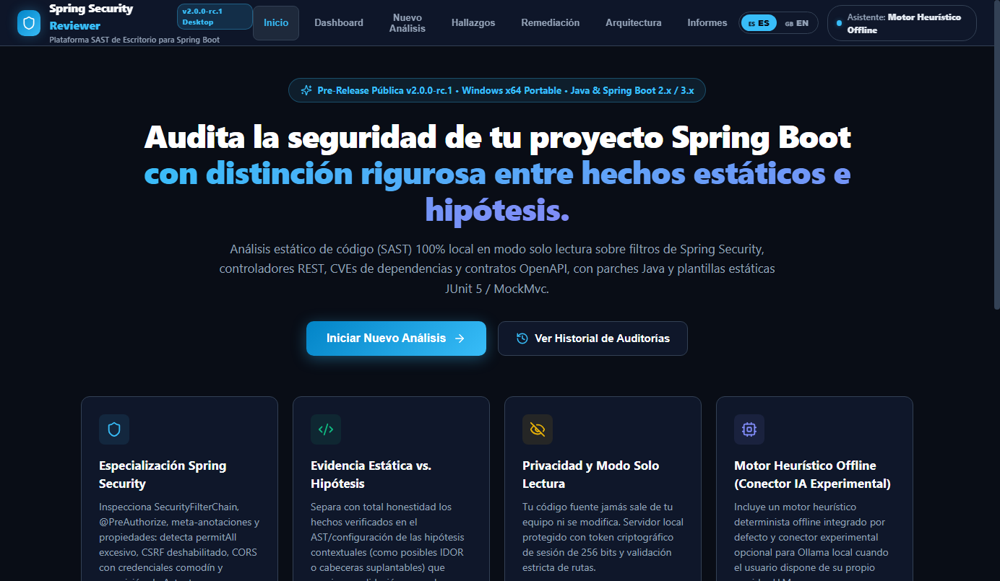
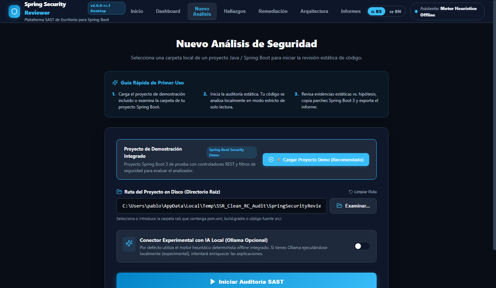
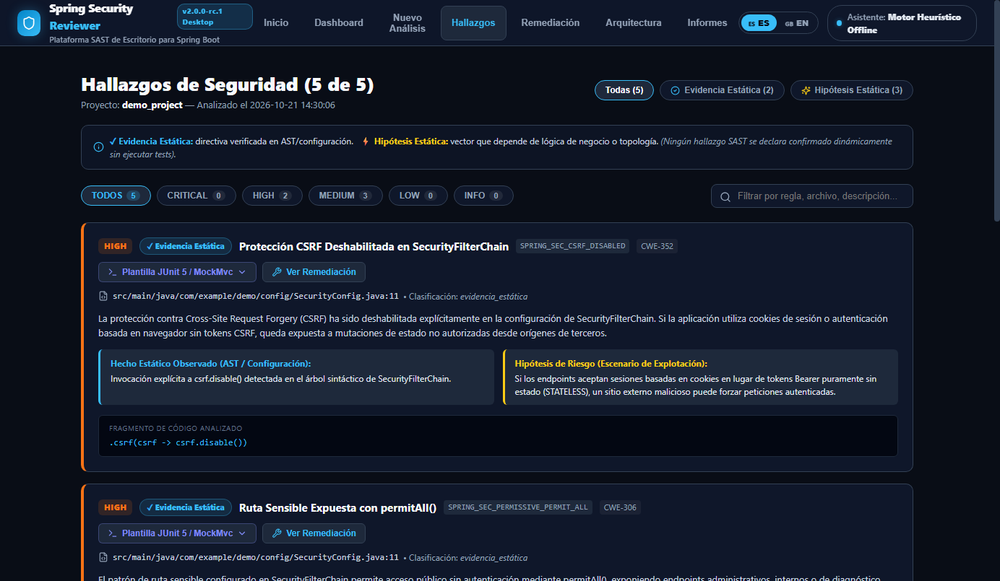
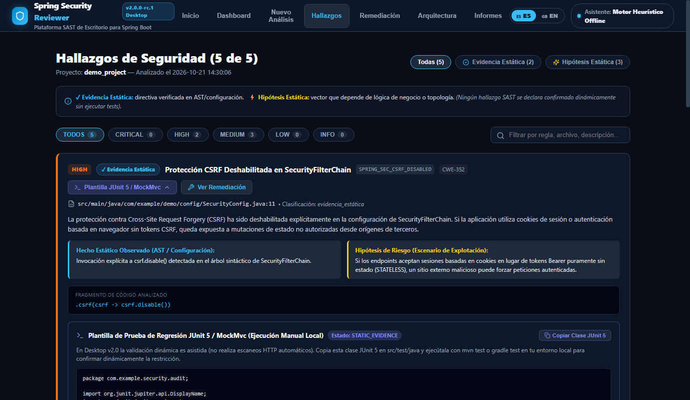
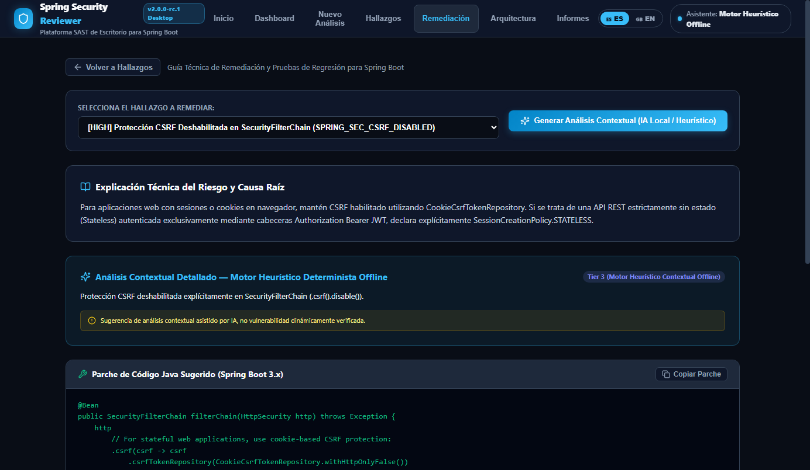
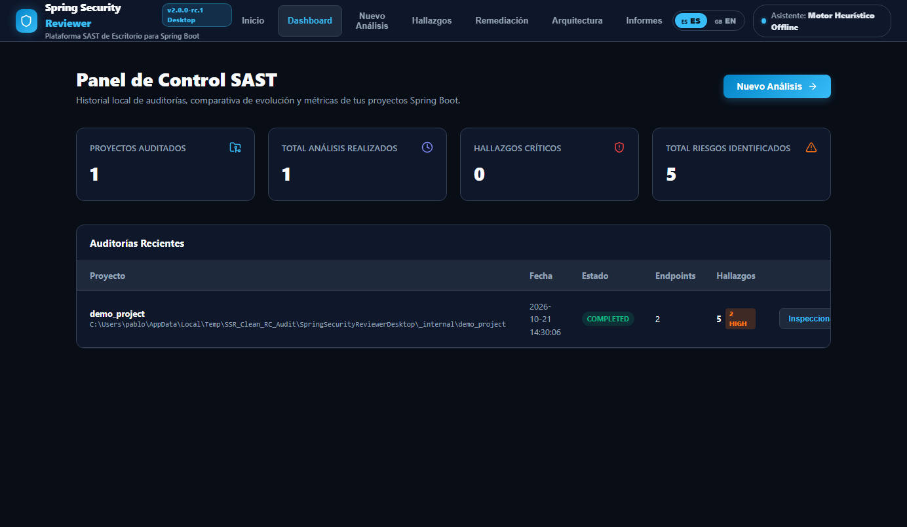

# Spring Security Reviewer Desktop — Public Releases Repository 🛡️

**Versión actual / Current Pre-Release:** `v2.0.0-rc.1` (Public Beta)  
**Plataforma / Platform:** Windows 10 / 11 (x64) Portable  
**Coste / Price:** **0 € / $0 (Freeware)**

[🇪🇸 Español](#español) | [🇬🇧 English](#english)

---

<a name="español"></a>
## 🇪🇸 Español

Bienvenido al repositorio oficial de distribución pública de **Spring Security Reviewer Desktop**.  
Este repositorio contiene exclusivamente los **paquetes ejecutables portables para Windows x64**, sumas de verificación criptográfica (`SHA-256`), documentación de seguridad y privacidad, avisos de licencias de terceros y seguimiento de incidencias (*Issues*). El código fuente del producto se mantiene en un repositorio privado.

---

### 🖥️ Capturas Reales de la Interfaz (`v2.0.0-rc.1`)

| Portada Principal | Nueva Auditoría y Proyecto Demo |
| :---: | :---: |
|  |  |

| Evidencias Estáticas vs. Hipótesis | Plantilla JUnit 5 / MockMvc |
| :---: | :---: |
|  |  |

| Centro de Remediación Offline | Mapa de Topología e Historial |
| :---: | :---: |
|  |  |

---

### ✅ ¿Qué incluye la versión `v2.0.0-rc.1` (Pre-Release Beta)?

1. **Ejecutable Portable Autónomo (`SpringSecurityReviewerDesktop.exe`):**
   - No requiere instalar Python, Java ni motores de base de datos externos.
   - Interfaz de escritorio nativa mediante **Microsoft Edge WebView2** con **modo de respaldo automático (Fallback)** al navegador predeterminado si WebView2 no está presente en el sistema.
   - Selector nativo de carpetas de Windows integrado.
2. **Motor SAST 100% Pasivo (Modo Solo Lectura):**
   - Analiza proyectos **Java y Spring Boot (2.x y 3.x)** con **Spring Security (5.x y 6.x)**.
   - Inspecciona árboles sintácticos Java (`AST`), archivos `application.properties` / `application.yml`, manifiestos `pom.xml` / `build.gradle` y contratos OpenAPI.
   - **Seguridad al abrir código de terceros:** Jamás compila ni ejecuta `mvn`, `gradle`, `javac` ni bytecode del proyecto analizado.
3. **Diferenciación Rigurosa entre Evidencias Estáticas e Hipótesis:**
   - **`✓ Evidencia Estática (STATIC_EVIDENCE)`:** Hechos comprobados directamente en el AST o configuración (ej. `.csrf().disable()`, `.permitAll()` en rutas administrativas, comodines CORS con credenciales, exposición de Actuator `*`, consola H2 habilitada, secretos en texto plano y CVEs en dependencias).
   - **`⚡ Hipótesis Estática (HYPOTHESIS)`:** Patrones sensibles al contexto arquitectónico (posibles IDOR/BOLA en `{id}`, cabeceras `@RequestHeader("X-User-Id")` suplantables, endpoints mutantes sin `@PreAuthorize`) que requieren verificación manual.
   - **Compromiso de honestidad técnica:** Ningún hallazgo estático se etiqueta jamás como vulnerabilidad confirmada dinámicamente.
4. **Motor Heurístico Determinista Offline y Plantillas JUnit 5 / MockMvc:**
   - Genera explicaciones de causa raíz (ES/EN), parches de código Java para Spring Security y **plantillas estáticas de tests JUnit 5 + MockMvc** para ejecución manual local (`mvn test` / `gradle test`).
5. **Historial Local, Comparativas y Exportación:**
   - Base de datos e historial local en `%LOCALAPPDATA%\SpringSecurityReviewer`, comparación entre dos auditorías y exportación de informes en **Markdown (`.md`)** y **JSON (`.json`)**.

---

### 🧪 Alcance Honesto: Funcionalidades Experimentales y Hoja de Ruta (`v2.1+`)

| Módulo | Estado Real en `v2.0.0-rc.1` | Próximos Pasos Post-Beta (`v2.1+`) |
| :--- | :--- | :--- |
| **Motor SAST + Motor Heurístico Offline** | **Completo y Verificado (Activo por defecto)** | Ampliación continua del catálogo de reglas Spring Security. |
| **IA Local con LLM (Ollama / GGUF)** | **Conector Experimental Opcional:** El ZIP portable (`~21 MB`) **no** empaqueta modelos LLM de varios GB. Si el usuario ejecuta su propio servidor local **Ollama** (`127.0.0.1:11434`), puede activar el conector experimental; sin Ollama, funciona al 100% con el motor heurístico offline. | **Prioridad #1 post-beta:** Integración avanzada de IA local autocontenida. |
| **Validación Dinámica (DAST)** | **Solo Generación Estática de Plantillas JUnit 5:** No lanza ataques dinámicos ni tráfico HTTP en vivo. Genera código de prueba JUnit 5 / MockMvc para ejecución manual del desarrollador. | **Prioridad #2 post-beta:** Ejecución DAST real controlada sobre entornos locales de prueba. |

> [!NOTE]
> **Nota sobre el entorno de pruebas de `v2.0.0-rc.1`:** Las pruebas de validación del ejecutable portable (arranque sin Python en `PATH`, ventana nativa WebView2 y modo de respaldo, análisis SAST, exportación de informes, historial, seguridad del servidor local y escaneo con Microsoft Defender) se ejecutaron en un **entorno aislado del equipo anfitrión**, no en una máquina virtual (VM) independiente. En el directorio [`verification/`](verification/) se incluyen los scripts reproducibles (`Verify-CleanWindowsVM.ps1` y `WindowsSandbox-Test.wsb`) para validación en VM limpia.

---

### 🔐 Descarga, Verificación SHA-256 y Aviso sobre Ejecutable Sin Firmar

#### Paso 1: Descargar y verificar la integridad criptográfica (`SHA-256`)
Descarga `SpringSecurityReviewer-v2.0.0-rc.1-Windows-x64.zip` y [`SHA256SUMS.txt`](SHA256SUMS.txt) desde la pestaña **Releases**. Antes de descomprimir o ejecutar el programa, comprueba en PowerShell que el hash coincide exactamente:

```powershell
Get-FileHash .\SpringSecurityReviewer-v2.0.0-rc.1-Windows-x64.zip -Algorithm SHA256
Get-Content .\SHA256SUMS.txt
```

#### Paso 2: Información sobre Firma Digital, Windows Defender y SmartScreen

> [!WARNING]
> **Ejecutable sin firma Authenticode comercial — Buenas prácticas de seguridad:**
> 1. **Estado de firma:** Esta versión preliminar (`v2.0.0-rc.1`) se distribuye gratuitamente (`0 €`) y **no está firmada digitalmente** con un certificado comercial OV/EV Code Signing. Como consecuencia, **Microsoft Defender SmartScreen** puede mostrar una ventana de aviso al ejecutar `SpringSecurityReviewerDesktop.exe` por primera vez tras descargarlo de Internet.
> 2. **NO desactives Windows Defender ni tu antivirus:** Bajo ninguna circunstancia recomendamos desactivar Windows Defender ni omitir avisos de SmartScreen de manera indiscriminada.
> 3. **Verificación recomendada antes de abrir:**
>    - Confirma primero que el hash `SHA-256` del archivo `.zip` y de `SpringSecurityReviewerDesktop.exe` coincide carácter por carácter con [`SHA256SUMS.txt`](SHA256SUMS.txt).
>    - Ejecuta un análisis bajo demanda de la carpeta descomprimida con el motor oficial de Microsoft Defender:
>      ```powershell
>      & "C:\Program Files\Windows Defender\MpCmdRun.exe" -Scan -ScanType 3 -File "$PWD\SpringSecurityReviewerDesktop"
>      ```
>    - Solo si el hash `SHA-256` coincide exactamente y Microsoft Defender confirma `0 amenazas detectadas`, procede a iniciar el ejecutable.

---

<a name="english"></a>
## 🇬🇧 English

Welcome to the official public distribution repository for **Spring Security Reviewer Desktop**.  
This repository hosts the **standalone Windows x64 portable binaries**, cryptographic checksums (`SHA-256`), security and privacy documentation, third-party open-source attributions, and public issue tracking. Product source code is maintained in a private repository.

### ✅ Verified Core Features in `v2.0.0-rc.1` (Public Pre-Release Beta)

- **Zero-Dependency Windows x64 Portable Binary:** Runs out of the box without Python or Java installed on `PATH`. Uses native **Microsoft Edge WebView2** and automatically falls back to the system default browser if WebView2 Runtime is absent.
- **100% Passive Read-Only SAST Engine:** Audits Java ASTs, Spring Boot configuration files (`application.properties`, `application.yml`), Maven/Gradle manifests (`pom.xml`, `build.gradle`), and OpenAPI specs without ever executing `mvn`, `gradle`, or target project code.
- **Strict Separation Between Static Evidence & Risk Hypotheses:**
  - **`✓ Static Evidence (STATIC_EVIDENCE)`:** Direct AST/configuration facts (disabled CSRF, sensitive `permitAll()`, wildcard CORS with credentials, exposed Actuators, enabled H2 console, plaintext secrets, and dependency CVEs).
  - **`⚡ Static Hypothesis (HYPOTHESIS)`:** Context-dependent risk vectors (potential IDOR/BOLA on `{id}` parameters, spoofable `@RequestHeader("X-User-Id")`, mutating endpoints missing `@PreAuthorize`) requiring manual review.
  - **Honesty Policy:** No static finding is ever presented as a dynamically confirmed vulnerability.
- **Built-in Deterministic Offline Heuristic Engine & JUnit 5 Templates:** Generates bilingual (ES/EN) root-cause explanations, Spring Security code patches, and static JUnit 5 + MockMvc regression test classes for manual execution (`mvn test` / `gradle test`).

### 🧪 Honest Scope: Experimental Connectors & Post-Beta Roadmap (`v2.1+`)

- **Local LLM AI (Experimental Optional Connector):** `v2.0.0-rc.1` uses the built-in **Deterministic Offline Heuristic Engine** by default and does not bundle multi-GB LLM models. An optional experimental connector is included for users running a local **Ollama** server (`127.0.0.1:11434`). Advanced local AI integration is **Priority #1** after this public beta.
- **Dynamic Testing / DAST (Static Test Templates Only):** `v2.0.0-rc.1` does **not** perform automated live DAST exploitation; it generates static JUnit 5 / MockMvc regression test code for manual local execution. Real DAST integration is **Priority #2** post-beta.
- **Pre-Release Verification Environment Note:** Verification tests for `v2.0.0-rc.1` (`Verify-CleanWindowsVM.ps1`) were executed in an **isolated environment on the host machine** (stripped `PATH` without Python/Node and isolated `LOCALAPPDATA`), not in an independent hypervisor VM. Reproducible scripts for clean VM testing are included in [`verification/`](verification/).

### 🔐Unsigned Binary Notice & SHA-256 Verification

- `v2.0.0-rc.1` is an **unsigned pre-release binary** (no commercial OV/EV Authenticode certificate applied yet).
- **Never disable Windows Defender** or blindly bypass SmartScreen warnings. Always verify the `SHA-256` checksum of the downloaded archive against [`SHA256SUMS.txt`](SHA256SUMS.txt) and scan the extracted directory with Microsoft Defender (`MpCmdRun.exe -Scan -ScanType 3`) before launching.

---

### 📄 Documentación Adicional / Additional Documentation

- [**Notas de la Versión / Release Notes (`RELEASE_NOTES.md`)**](RELEASE_NOTES.md)
- [**Seguridad, Privacidad y Limitaciones (`SECURITY_AND_PRIVACY.md`)**](SECURITY_AND_PRIVACY.md)
- [**Acuerdo de Licencia Freeware Propietario (`LICENSE`)**](LICENSE)
- [**Avisos y Licencias de Terceros (`THIRD_PARTY_NOTICES.txt`)**](THIRD_PARTY_NOTICES.txt)
- [**Sumas de Verificación Criptográfica (`SHA256SUMS.txt`)**](SHA256SUMS.txt)
